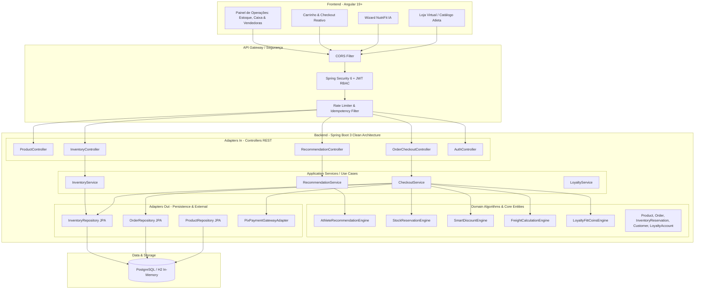
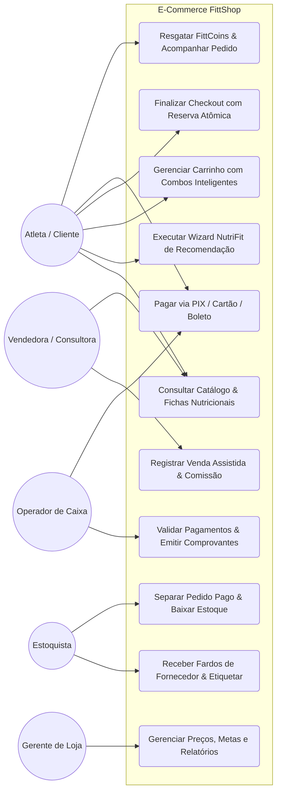
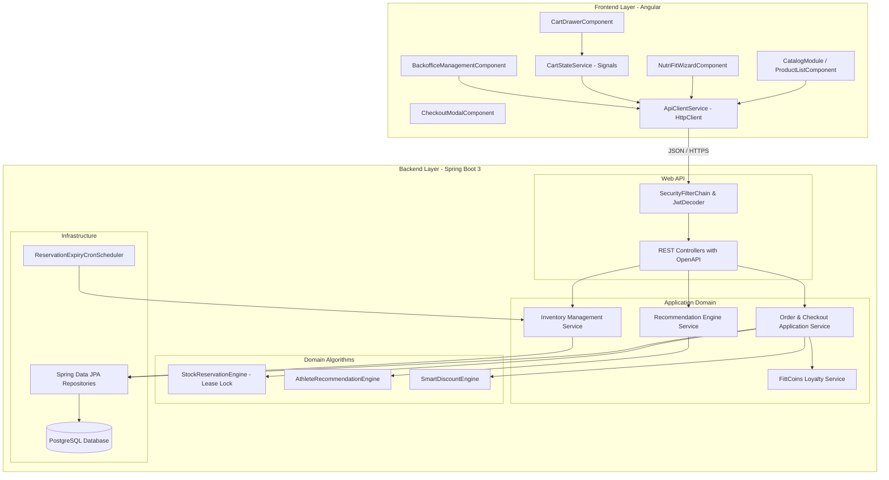
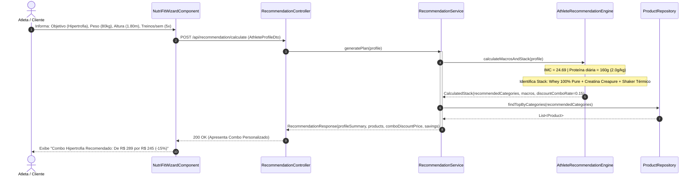
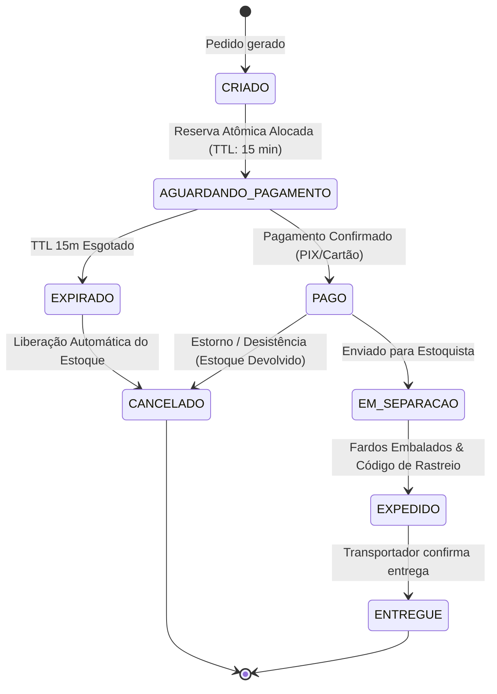
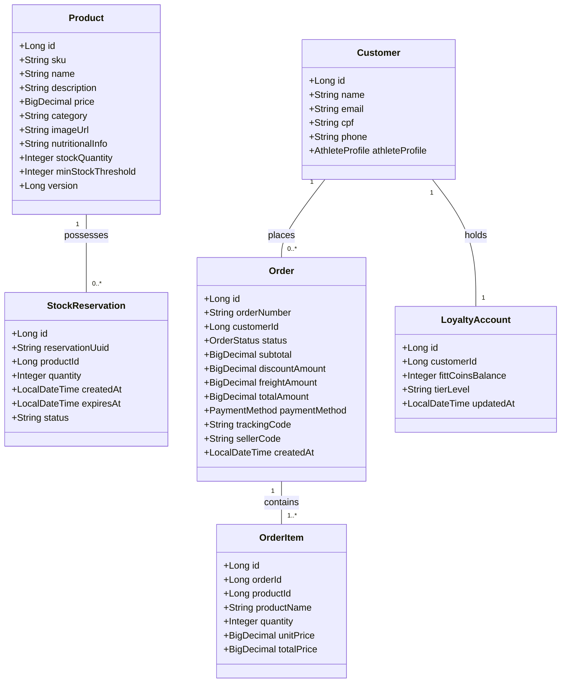

<!-- AUDIENCE: ARCHITECTS, DEVELOPERS & TECH LEADS -->

# 🏛️ ARCHITECTURE — Arquitetura Canônica do E-Commerce FittShop

> **Visão Técnica, Diagramas UML (Casos de Uso, Sequência, Estados, Componentes), Modelo de Domínio e DevSecOps**  
> **Versão:** 1.0.0 Enterprise  
> **Padrões:** Clean Architecture / Hexagonal Ports & Adapters / Event-Driven Ready / Reactive Frontend  
> **Stack:** Java 21 LTS + Spring Boot 3.3.x (Backend) | Angular 19+ Standalone (Frontend)

---

## 1. VISÃO GERAL DA ARQUITETURA

A arquitetura do **FittShop** foi concebida sob os princípios da **Clean Architecture** (Arquitetura Limpa) e **Domain-Driven Design (DDD)**, garantindo desacoplamento entre regras de negócio corporativas, orquestração de casos de uso e detalhes de infraestrutura (bancos de dados, gateways e frameworks).



---

## 2. DIAGRAMA DE CASOS DE USO (USE CASE)

O sistema integra tanto a experiência de compra do atleta no e-commerce quanto o fluxo operacional físico da loja originado do mapeamento inicial (`projeto.drawio` e `FUNCIONALIDADES V2.docx`).



---

## 3. DIAGRAMA DE COMPONENTES



---

## 4. DIAGRAMA DE SEQUÊNCIA: CHECKOUT, RESERVA ATÔMICA & PAGAMENTO

Este diagrama detalha a execução determinística do checkout com prevenção de concorrência e lease temporário de 15 minutos:

```mermaid
sequenceDiagram
    autonumber
    actor Atleta as Atleta / Cliente
    participant UI as Angular Frontend
    participant API as OrderCheckoutController
    participant Svc as CheckoutService
    participant InvAlg as StockReservationEngine
    participant Repo as InventoryRepository (DB)
    participant Gateway as PixGatewayAdapter
    participant Cron as ExpiryCronScheduler

    Atleta->>UI: Clica em "Finalizar Pedido com PIX"
    UI->>API: POST /api/checkout (itens, endereco, cpf, fittCoins)
    API->>Svc: processCheckout(request)
    
    activate Svc
    Svc->>InvAlg: reserveItems(cartItems, TTL=900s)
    activate InvAlg
    InvAlg->>Repo: SELECT FOR UPDATE / Optimistic Lock
    Note over InvAlg,Repo: Valida saldo físico - reservas ativas
    alt Saldo Insuficiente
        InvAlg-->>Svc: throw InsufficientStockException
        Svc-->>API: 409 Conflict (Produto X Indisponível)
        API-->>UI: Exibe alerta amigável de estoque esgotado
    else Saldo Suficiente
        InvAlg->>Repo: INSERT INTO stock_reservation (status='ACTIVE', expires_at=now+15m)
        InvAlg-->>Svc: ReservationResult(reservationId, expiresAt)
    end
    deactivate InvAlg

    Svc->>Gateway: createPixCharge(orderId, amount)
    Gateway-->>Svc: PixCharge(qrCodeBase64, copiaECola, txId)
    Svc->>Repo: INSERT INTO orders (status='AGUARDANDO_PAGAMENTO', reservation_id)
    Svc-->>API: CheckoutResponse(orderId, pixDetails, expiresAt)
    deactivate Svc
    API-->>UI: 201 Created (Exibe QR Code na Tela)
    UI-->>Atleta: Apresenta QR Code & Contagem Regressiva (15:00)

    par Fluxo de Pagamento Aprovado
        Atleta->>Gateway: Paga via App do Banco
        Gateway->>API: POST /api/webhooks/pix (txId, status='PAID')
        API->>Svc: confirmPayment(orderId)
        Svc->>Repo: UPDATE orders SET status='PAGO'
        Svc->>InvAlg: commitReservation(reservationId)
        InvAlg->>Repo: UPDATE stock SET quantity = quantity - reserved; DELETE reservation
        Svc->>Repo: INSERT INTO loyalty_transaction (+FittCoins)
        API-->>Gateway: 200 OK
    and Fluxo de Timeout / Não Pago
        Cron->>Svc: checkExpiredReservations()
        Note over Cron,Svc: Se passar 15 minutos sem pagamento:
        Svc->>InvAlg: releaseExpiredLease(reservationId)
        InvAlg->>Repo: UPDATE orders SET status='CANCELADO'; DELETE reservation
    end
```

---

## 5. DIAGRAMA DE SEQUÊNCIA: MOTOR NUTRIFIT DE RECOMENDAÇÃO



---

## 6. DIAGRAMA DE ESTADOS (FSM) — CICLO DE VIDA DO PEDIDO & ESTOQUE



---

## 7. MODELO DE DADOS / DIAGRAMA DE CLASSES DE DOMÍNIO



---

## 8. MATRIZ DEVSECOPS & SEGURANÇA (OWASP TOP 10)

| Vetor de Risco | Mitigação Implementada no FittShop |
|:---|:---|
| **A01: Quebra de Controle de Acesso** | Spring Security 6 com RBAC granular (`@PreAuthorize("hasRole('STOCKIST')")`). |
| **A02: Falhas Criptográficas** | Senhas com BCrypt (cost factor 12); tokens JWT com chave HMAC-SHA256 rotativa. |
| **A03: Injeção (SQL/NoSQL/Command)** | Spring Data JPA com PreparedStatements parametrizados; zero uso de `eval()` ou comandos em shell sem sanitização. |
| **A04: Design Inseguro (Race Conditions)** | Bloqueio otimista (`@Version`) no estoque e reservas atômicas com TTL estrito. |
| **A05: Configuração Insegura** | Headers HTTP de segurança (HSTS, X-Content-Type-Options: nosniff, CSP, X-Frame-Options: DENY). |
| **A07: Falhas de Identificação e Autenticação** | Proteção contra força bruta via Rate Limiting; expiração estrita de tokens JWT (60 minutos). |
| **A08: Falhas de Integridade de Software (Supply Chain)** | Travis/GitHub CI com `--ignore-scripts` e dependências fixadas no Maven e npm. |
