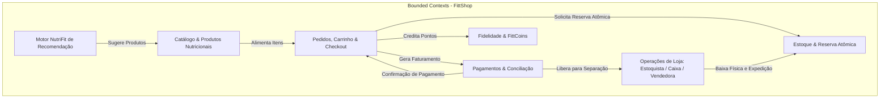
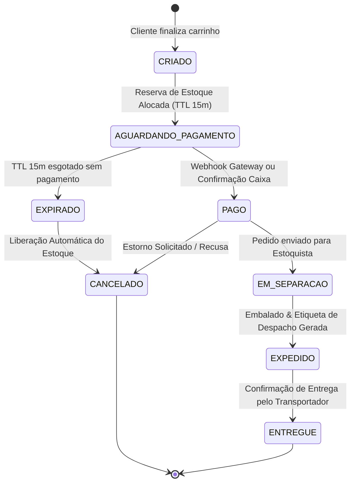

<!-- AUDIENCE: AGENT / LLM & PRODUCT ENGINEERS (Discovery Gate & Domain Contract) -->

# 🧭 SPEC_DISCOVERY — E-Commerce FittShop (Fitness & Gym Performance)

> **Documento Canônico de Elicitação, Descoberta, Regras de Negócio e Algoritmos de Domínio**  
> **Versão:** 1.0.0 Enterprise  
> **Status:** Aprovado pelo Orchestrator Gate & DevSecOps  
> **Stack Primária:** Java 21 LTS + Spring Boot 3.3.x (Clean Architecture) | Angular 19+ (Signals & Standalone)

---

## 1. VISÃO DO PRODUTO & TESE DE NEGÓCIO

- **Nome do Sistema:** **FittShop** (Loja Virtual & Plataforma Omnichannel para Atletas e Praticantes de Academia)
- **Identidade Visual & Marca:** FittShop — Energia, Alta Performance, Nutrição Esportiva e Vestuário de Academia (símbolo: banana estilizada/energia natural combinada com estética dark athletic neon).
- **Público-Alvo:** 
  1. *Atletas e Praticantes de Musculação / Crossfit / Luta:* buscam suplementos de alta pureza (Creapure, Whey 100%, Beta-Alanina), vestuário técnico (dry-fit, compressão) e acessórios pesados (cinturões, munhequeiras, straps).
  2. *Iniciantes / Intermediários em Recomposição Corporal:* buscam orientação e combos prontos focados no objetivo (Hipertrofia, Queima de Gordura, Definição, Resistência).
  3. *Equipe Operacional Interna (baseada na matriz da empresa):* Vendedoras/Consultoras, Caixas, Estoquistas, Embaladoras, Gerentes de Loja e Fornecedores.
- **Problema Real / Dor Crônica do Mercado:**
  - Lojas de suplementos genéricas vendem produtos sem direcionamento para o objetivo do cliente, gerando compras inadequadas e frustração nos resultados.
  - Ruptura de estoque e atraso na expedição: clientes de academia dependem do seu suplemento no ciclo de treino e não podem esperar semanas.
  - Desconexão entre loja virtual e equipe física (estoquistas, vendedoras comissariadas e caixas).
- **Proposta de Valor & Diferencial Competitivo:**
  - **Consultor Nutricional & Revisor de Metas (Algoritmo NutriFit):** Recomendação inteligente de suplementação e equipamentos baseada no biotipo, objetivo (bulking/cutting) e frequência de treino.
  - **Reserva Atômica de Estoque com Lease TTL:** Elimina cancelamentos por falta de produto e "overselling".
  - **Gamificação & Fidelidade FittCoins:** Recompensas reais a cada treino/compra para abater em pedidos futuros.
  - **Gestão Integrada de Papéis:** Módulo unificado para Vendedora (comissões/vendas assistidas), Estoquista (recebimento/etiquetagem/baixa) e Caixa.
- **Métricas Chave de Sucesso (KPIs):**
  - Taxa de Conversão do Carrinho > 3.8%
  - Tempo de Checkout Completo < 45 segundos
  - Precisão de Estoque = 100% (zero ocorrências de overselling através de trava atômica)
  - Latência p95 das APIs de Catálogo e Cálculo de Frete < 80ms

---

## 2. BOUNDED CONTEXTS & ESCOPO DO SISTEMA



### 2.1. Escopo Positivo (O que ESTÁ DENTRO)
- Catálogo de produtos especializado por categorias esportivas (Suplementos, Vestuário, Acessórios, Combos de Alta Performance).
- Wizard interativo de recomendação por objetivo físico (Hipertrofia, Definição, Força, Resistência).
- Carrinho de compras reativo com cálculo de frete dinâmico por CEP, cupom e bonificação FittCoins.
- Checkout transparente com suporte a PIX instantâneo (com QR Code copia-e-cola dinâmico), Cartão de Crédito e Boleto.
- Motor de reserva temporária de estoque com timeout (Lease TTL de 15 minutos).
- Backoffice com permissões segregadas (RBAC):
  - **Estoquista:** Conferência de entrada de fardos de fornecedores, etiquetagem, reposição e despacho.
  - **Caixa:** Validação de vendas, confirmação de recebimento e emissão de notas.
  - **Vendedora:** Registro de vendas assistidas com tracking de comissão.
  - **Gerente / Admin:** Gestão de preços, relatórios, cadastros e parametrizações.

### 2.2. Escopo Negativo / Anti-Scope
- ❌ Não haverá integração com carteiras de criptomoedas ou moedas fiduciárias estrangeiras (operações exclusivas em BRL).
- ❌ Não haverá prescrição médica individualizada (recomendações são baseadas em diretrizes nutricionais públicas da ANVISA e tabelas padrão de macronutrientes).
- ❌ Não haverá logística reversa de produtos alimentícios com embalagem violada (por determinação sanitária da ANVISA).

---

## 3. REQUISITOS DO SISTEMA

### 3.1. Requisitos Funcionais (RF)

| ID | Nome | Descrição |
|:---|:---|:---|
| **RF01** | Catálogo com Filtros Esportivos | O sistema deve listar produtos categorizados por Suplementos, Roupas, Acessórios e Combos, permitindo filtros por objetivo físico, marca, tamanho, sabor e faixa de preço. |
| **RF02** | Ficha Técnica Nutricional | O sistema deve exibir para suplementos: tabela nutricional, laudos de pureza, lista de aminoácidos, alergênicos e modo de uso recomendado. |
| **RF03** | Motor de Recomendação (NutriFit) | O sistema deve calcular uma recomendação personalizada de suplementos e acessórios com base em: Peso, Altura, Frequência Semanal e Objetivo (Hipertrofia, Definição, etc.). |
| **RF04** | Combos Inteligentes ("Compre Junto") | O sistema deve agrupar produtos sinérgicos (ex: Creatina + Whey + Shaker) aplicando desconto progressivo calculado automaticamente. |
| **RF05** | Carrinho de Compras Reativo | O cliente pode adicionar, remover, alterar quantidades e visualizar subtotal, frete estimado e descontos em tempo real. |
| **RF06** | Reserva Atômica de Estoque | Ao iniciar o checkout, o sistema deve reservar atomicamente os itens do pedido com lease de 15 minutos. Se o pagamento expirar, o estoque volta automaticamente à disponibilidade. |
| **RF07** | Cálculo de Frete e Prazos | O sistema deve calcular frete via CEP com regras de frete grátis por região para pedidos acima do valor estipulado (ex: R$ 199,00 Sul/Sudeste). |
| **RF08** | Checkout Multi-forma | Suporte a pagamento via PIX (QR Code e chave Copia-e-Cola), Cartão de Crédito (até 10x sem juros) e Boleto Bancário. |
| **RF09** | Programa de Fidelidade FittCoins | A cada R$ 10,00 gastos, o cliente acumula 1 FittCoin (equivalente a R$ 0,50 de desconto para resgate em pedidos futuros, com teto de 20% do pedido). |
| **RF10** | Rastreamento do Pedido (FSM) | O cliente pode acompanhar as etapas do pedido: `CRIADO`, `AGUARDANDO_PAGAMENTO`, `PAGO`, `EM_SEPARACAO`, `EXPEDIDO`, `ENTREGUE`, `CANCELADO`. |
| **RF11** | Painel do Estoquista | Permite ao estoquista conferir itens para separação, imprimir etiquetas, confirmar baixa de fardos e cadastrar lotes com validade. |
| **RF12** | Painel do Caixa | Permite validar pedidos pagos, registrar pagamentos manuais ou via PDV e emitir nota fiscal/comprovante. |
| **RF13** | Gestão de Vendedoras & Comissões | Permite vincular um código de vendedora/consultora ao pedido para cálculo de comissão (3% a 5% sobre a venda). |
| **RF14** | Notificações de Status | O sistema deve gerar alertas visuais e eventos de atualização de status do pedido para o cliente. |
| **RF15** | Autenticação & Perfis (RBAC) | Segregação estrita de papéis: `ROLE_CUSTOMER`, `ROLE_SELLER`, `ROLE_STOCKIST`, `ROLE_CASHIER`, `ROLE_MANAGER`, `ROLE_ADMIN`. |

### 3.2. Requisitos Não-Funcionais (RNF)

| ID | Categoria | Descrição |
|:---|:---|:---|
| **RNF01** | Performance | Tempo de resposta das APIs REST < 100ms para 95% das requisições sob carga normal. |
| **RNF02** | Concorrência | O controle de estoque deve usar bloqueio otimista (`@Version`) e transações isoladas para prevenir condições de corrida em promoções com pico de tráfego. |
| **RNF03** | Segurança (SAST) | Zero vulnerabilidades de injeção SQL, XSS, CSRF ou CWE-78 (validado pelo pipeline SAST do Agent Master DevSecOps). |
| **RNF04** | Acessibilidade | Interface desenvolvida em conformidade com WCAG 2.1 AA (contraste mínimo de 4.5:1, navegação por teclado e semântica HTML5). |
| **RNF05** | Responsividade | UI 100% responsiva (Mobile-first), otimizada para smartphones (360px) até desktops 4K. |
| **RNF06** | Disponibilidade | Arquitetura conteinerizada stateless permitindo escalabilidade horizontal com Docker e Docker Compose. |
| **RNF07** | Idempotência | Endpoints de pagamento e checkout devem ser estritamente idempotentes via header `X-Idempotency-Key`. |
| **RNF08** | Auditoria e Logs | Registro imutável de todas as transações financeiras e alterações de estoque com timestamp, usuário e operação realizada. |

---

## 4. REGRAS DE NEGÓCIO INVARIANTES (RN)

- **RN01 (Validade de Suplementos):** Nenhum suplemento pode ser expedido se a data de validade do lote estiver a menos de 45 dias do vencimento.
- **RN02 (Reserva Temporária com TTL):** Ao fechar o carrinho para checkout, o estoque é reservado por exatamente 15 minutos (900 segundos). Caso a confirmação de pagamento não ocorra, a reserva é cancelada e o saldo restaurado.
- **RN03 (Trava de Overselling):** É fisicamente proibido aceitar pedido com saldo de estoque disponível menor que a quantidade requisitada (`saldo_disponivel = saldo_fisico - reservas_ativas`).
- **RN04 (Teto de Resgate de FittCoins):** O desconto aplicado via FittCoins não pode exceder 20% do valor total dos produtos no carrinho.
- **RN05 (Frete Grátis):** Região Sudeste tem frete grátis para compras a partir de R$ 199,00; demais regiões a partir de R$ 299,00.
- **RN06 (Desconto de Combos):** Combos pré-definidos (ex: Creatina + Whey) aplicam desconto automático de 15% em relação à soma dos preços avulsos.
- **RN07 (Idempotência no Pagamento):** O mesmo payload de pagamento enviado com a mesma chave de idempotência nos últimos 30 minutos deve retornar a transação já existente sem nova cobrança.
- **RN08 (Comissão de Vendedora):** Vendedoras cadastradas recebem 4% de comissão sobre o valor líquido dos produtos, creditada somente após o pedido atingir o status `PAGO`.

---

## 5. ALGORITMOS DE NEGÓCIO DETALHADOS

### Algoritmo 1: Motor de Recomendação por Perfil de Treino (NutriFit Goal Engine)
- **Objetivo:** Calcular as necessidades de suplementação e vestuário com base nas variáveis do atleta:
  $$IMC = \frac{peso}{altura^2}$$
  - Se objetivo == **HIPERTROFIA**:
    - Proteína recomendada: $2.0 \times peso$ gramas/dia.
    - Stack Principal: Whey Protein Concentrado/Isolado + Creatina Creapure 5g/dia + Beta-Alanina.
    - Acessórios recomendados: Shaker Térmico + Straps de Pegada.
  - Se objetivo == **DEFINICAO / EMAGRECIMENTO**:
    - Proteína recomendada: $2.2 \times peso$ gramas/dia.
    - Stack Principal: Whey Isolado Zero Carbo + Termogênico / Cafeína Anidra + L-Carnitina.
    - Vestuário recomendado: Roupa Térmica / Compressão.
  - Se objetivo == **FORCA / POWERLIFTING**:
    - Stack Principal: Creatina Creapure + Pré-Treino Alta Dosagem + Glutamina.
    - Acessórios recomendados: Cinturão de Couro + Joelheiras de Neoprene 7mm + Munhequeiras.
  - Se objetivo == **RESISTENCIA / CARDIO**:
    - Stack Principal: Isotônico / Palatinose + BCAA / Eletrólitos + Whey Hidrolisado.
    - Acessórios recomendados: Garrafa 2 Litros + Cinto de Hidratação.

### Algoritmo 2: Motor de Reserva Atômica com Lease TTL (Atomic Inventory Lease)
```
Entrada: CartItems [productId, quantity], customerId, ttlSeconds = 900
Processo:
1. Iniciar transação ACID (SERIALIZABLE ou SELECT FOR UPDATE).
2. Para cada item:
     disponivel = estoqueFisico - SUM(reservasAtivas)
     SE quantidade > disponivel:
         Rollback transação
         Retornar ERRO_ESTOQUE_INSUFICIENTE(productId, disponivel)
3. Inserir registro em `stock_reservation` com:
     reservationId = UUID()
     status = 'ACTIVE'
     expiresAt = now() + ttlSeconds
4. Retornar reservationId e expiração.
```

### Algoritmo 3: Motor de Desconto e Combos Inteligentes (Smart Stacking Discount)
$$Subtotal = \sum (precoUnitario_i \times qtd_i)$$
$$DescontoCombo = \begin{cases} Subtotal \times 0.15 & \text{se carrinho contém Whey + Creatina} \\ 0 & \text{caso contrário} \end{cases}$$
$$DescontoCupom = Subtotal \times taxaCupom$$
$$DescontoFittCoins = \min(fittCoinsUtilizadas \times 0.50, Subtotal \times 0.20)$$
$$TotalFinal = Subtotal - DescontoCombo - DescontoCupom - DescontoFittCoins + Frete$$

### Algoritmo 4: Roteador de Frete FittFreight
- Cálculo por Faixa de CEP e Peso Total com Regra de Isenção:
  - Faixa 01000-000 a 19999-999 (SP Capital/Interior): Base R$ 14,90 + R$ 1,50/kg excedente (Grátis acima de R$ 199,00).
  - Demais regiões Sul/Sudeste: Base R$ 22,90 + R$ 2,00/kg excedente (Grátis acima de R$ 199,00).
  - Norte/Nordeste/Centro-Oeste: Base R$ 34,90 + R$ 3,50/kg excedente (Grátis acima de R$ 299,00).

---

## 6. MÁQUINA DE ESTADOS FINITA (FSM) DO PEDIDO



---

## 7. MATRIZ DE TESTES BDD (GIVEN / WHEN / THEN)

### Cenário 1: Compra com Reserva de Estoque e Pagamento PIX Aprovado
- **Dado (Given):** Que o produto "Creatina Creapure 300g" possui 10 unidades disponíveis em estoque.
- **Quando (When):** O cliente atleta adiciona 2 unidades e solicita checkout via PIX.
- **Então (Then):** O estoque disponível cai para 8 unidades com reserva ativa de 15 minutos;
- **E (And):** Quando o webhook do PIX confirma o pagamento, o pedido transiciona para `PAGO` e a reserva é consolidada em baixa definitiva de estoque.

### Cenário 2: Expiracão de Reserva de Estoque por Falta de Pagamento
- **Dado (Given):** Que o cliente gerou um pedido com 1 pote de Whey Protein com reserva ativa.
- **Quando (When):** O tempo de 15 minutos expirar sem sinal de pagamento.
- **Então (Then):** O status do pedido transiciona para `EXPIRADO` e subsequentemente `CANCELADO`;
- **E (And):** O pote de Whey Protein é reincorporado imediatamente ao saldo disponível para outros atletas.
